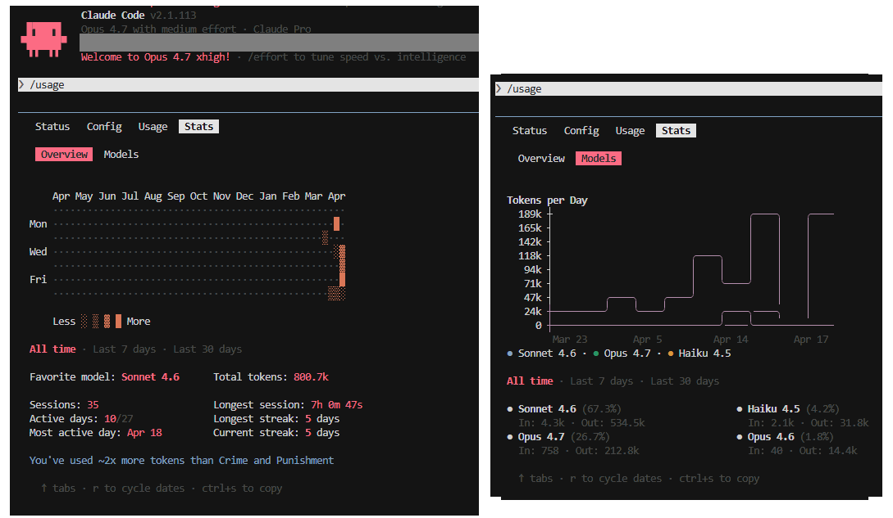

# 👋 Welcome! I'm Francisco Alejandro Retamal Reinoso

**Information Technology Engineer | Thinking about what comes next: BCI, nanotech, robotics, AI**

---

I hold a five-year *Ingeniero Civil Informático* degree (Information Technology Engineering) — internationally recognized as between a Bachelor's and a Master's level per ZAB assessment. During my program I also completed all but one course of the Master's in Engineering Sciences track; I chose to redirect again toward the Startup School specialization instead of the common path of the majority, the "Capstone project", as I did when I chose the Master's track. The academic depth of that near-Master's path remains part of what I bring — it's a distinction I keep visible: it matters in contexts where academic depth is weighed seriously, including future doctoral or research paths.

Self-taught long before university, curious by nature, I began early on to build intuition for how technologies connect and compound, quick to pick up any technology I need. And that has told me the relevant thing isn't the next job, it's the next decade of technology. I've been writing code since well before university, and I'm looking for my first professional role not to clock in, but to focus that direction and build seriously. Based in Chile, open to relocation.

---

## Technical Skills

**Before 2022 (pre-LLM era)**

- **Main:** Python, HTML, CSS, JavaScript, jQuery
- **Also worked with:** PHP, SQL, C, C++, R, Linux, Laravel, VBA for Excel, AutoHotkey, MQL4, Basic for Atari

**What I've learnt these last few years**

- AI agents (Claude Code, Codex, Antigravity), Cursor, Supabase, Vercel, Resend. Programming through agents, I built [LookThis.One](https://lookthis.one) in Next.js, TypeScript and React, with Prisma and Supabase: webhooks for Lemon Squeezy payments and subscriptions (state updates, errors and retries), a Hostinger webhook that logs incoming email into an admin panel, transactional email with Resend, bot protection with Cloudflare Turnstile, automated backups to Cloudflare R2, MFA and role-based access, and automated deploys to Vercel with tests and CI

---

## Interests

- **Software Engineering** - building clean, efficient, and maintainable systems
- **Brain-Computer Interfaces** - the intersection of computing and the human brain
- **Nanotechnology** - emerging tech at the smallest scale
- **Robotics** - machines that act in the physical world
- **AI agents** - systems that plan, act and review their own work

---

## Currently

- 🎓 Graduated in May 2025 (though I actually finished everything by late 2024)
- 🔍 **Open to work: looking for a job in Chile since October 2026**
  - After graduating I had my degree assessed in Germany (ZAB, September 2025) and from October 2025 applied for jobs there. In my experience, roles open to candidates from abroad mostly ask for a Master's degree
  - Then I built my own web app, [LookThis.One](https://lookthis.one), in production since July 2026
  - Still open to Germany, including a research associate position at a university (*wissenschaftlicher Mitarbeiter*)
- 📚 Always learning the next tool I need

*Animation of usage snapshots from April 9 to September 16, 2026.*

- [LookThis.One](https://lookthis.one) is the second version of the project. Its code lives in a private repository under my [company account](https://github.com/LookThisOne)
- Since May 2026, working almost exclusively with Claude Code. Out of that work came two Claude Code skills for my own development workflow: [claude-skills](https://github.com/AlejandroPu/claude-skills)
- Other recent public projects: [stdoer-npp-plugin](https://github.com/AlejandroPu/stdoer-npp-plugin), [teleprompter-project](https://github.com/AlejandroPu/teleprompter-project), [LookThisOne-v1](https://github.com/AlejandroPu/LookThisOne-v1)
- [claude-pair-sudoku](https://github.com/AlejandroPu/claude-pair-sudoku) - evolved into a currently private repository that lives online at [cerebritos.cl/games](https://cerebritos.cl/games)

---

> [!IMPORTANT]
> Watch me code! Visit my [YouTube playlist here](https://www.youtube.com/playlist?list=PLLWpzRBlOIXRjvo-WCCYsJjXrnmcfHNSJ).
>
> ❗ **My programming and 'engineering' experience before university is much broader than what this GitHub shows.**

---

*Feel free to reach out*
- 💼 [LinkedIn](https://www.linkedin.com/in/franciscoalejandrorretamal/)
*Open to opportunities, collaborations, or just talk tech!*
